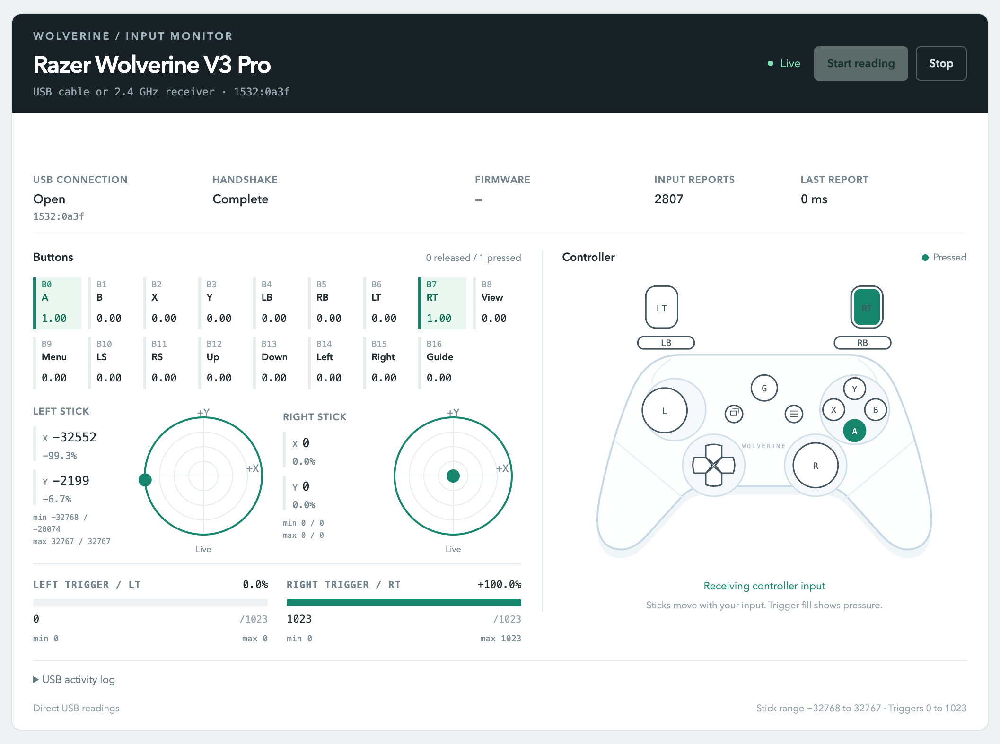
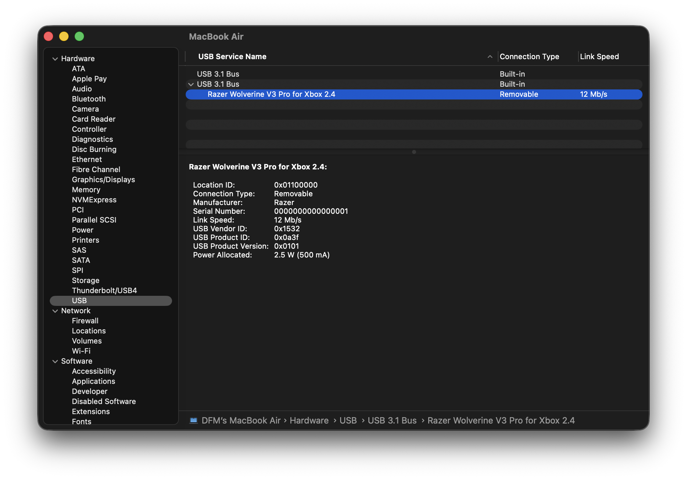
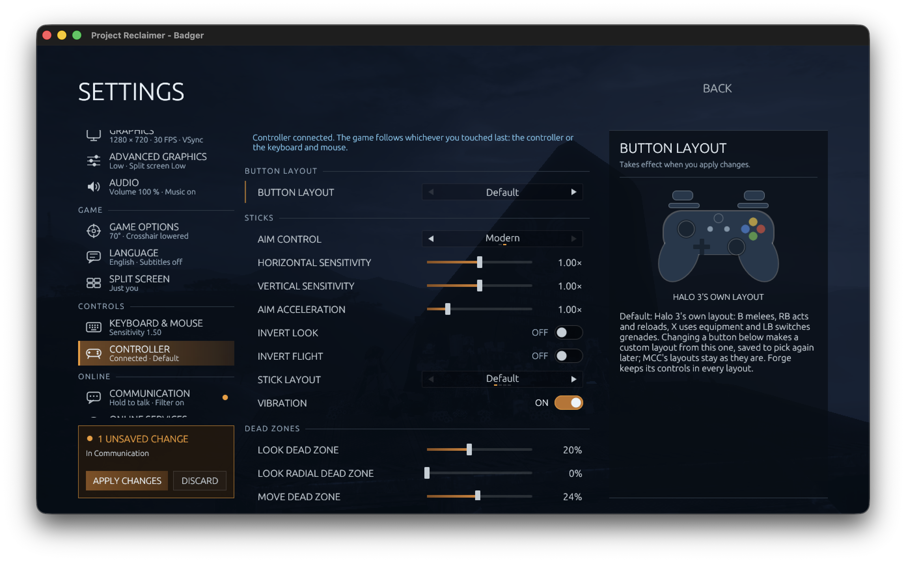

# Razer Wolverine for macOS

A userspace USB driver, live input monitor, and Wine adapter for the Razer Wolverine V3 Pro. Read stick positions, trigger pressure, and button presses over USB or the included 2.4 GHz receiver. Use the patched SDL2 library to pass controller input to Windows games through Wine's XInput API.



Actual wireless input on macOS, captured October 16, 2026. The monitor shows raw values, percentages, observed ranges, button highlights, and USB handshake status.

## What works

Tested on an Apple Silicon M3 Mac running macOS 26.3.

| Connection or feature | Verified status |
|---|---|
| Wired USB monitor | 2,840 input reports; both sticks and triggers reached their full ranges |
| 2.4 GHz wireless monitor | 5,087 input reports; both sticks and triggers reached their full ranges |
| Wireless input in Wine | XInput slot 0; 158 changing states with stick, trigger, and button input |
| Project Reclaimer 0.9.18 | Game logged `Controller 1 connected.`; in-game response still needs verification |
| Native macOS game controller | No system-wide HID or GameController device is created |
| Separate M1–M6 inputs | Not exposed as independent buttons by the monitor in normal Xbox mode |

Wireless capture can fail or stall during the security handshake, especially after switching readers. Restarting capture has recovered input, but a permanent reconnect fix has not been established. See [monitor troubleshooting](DASHBOARD.md#recover-capture).

The project runs in userspace. It needs no kernel extension, DriverKit installation, SIP change, or paid Apple Developer membership. The Wine installer uses an ad-hoc local signature; this is not a notarized system driver.

## Start the monitor

Install Apple's Command Line Tools, Homebrew, and Python 3 if they are not already available. Then run:

```bash
brew install libusb pkgconf
git clone https://github.com/davefmurray/razer-wolverine-macos.git
cd razer-wolverine-macos
make
python3 tools/dashboard.py
```

Open **http://127.0.0.1:8769** and press **Start reading**. Move the sticks and squeeze the triggers. A successful capture shows **Handshake Complete**, increasing input reports, and changing measurements.

After setup, double-click `launch.command` to build the reader, start the local server, and open the page. If the server is already running, the launcher opens that instance. Closing the server's Terminal window stops capture.

Choose one connection:

- **Wired:** connect the controller with a USB data cable in Xbox mode, with USB identity `1532:0a3f`.
- **Wireless:** connect the included receiver, unplug the controller's USB cable, and power on the controller. The receiver uses Razer HyperSpeed 2.4 GHz. No Bluetooth pairing in macOS is required.

**Only one reader can use the controller at a time.** Stop monitor capture before starting Wine. Close the game and any XInput test before starting the monitor. The browser window can stay open.

Read [DASHBOARD.md](DASHBOARD.md) for measurement ranges, status meanings, and recovery steps.

## Find the receiver in macOS

Open **System Information**, select **Hardware → USB**, and select **Razer Wolverine V3 Pro for Xbox 2.4**. You can launch System Information from Spotlight or by holding Option while opening the Apple menu.



This screenshot confirms that macOS detects the USB receiver. Its vendor ID is `0x1532` and product ID is `0x0a3f`. USB detection alone does not prove that the wireless controller is paired or sending input. Use the monitor for that check.

The adapter does not register a system-wide controller in macOS Game Controllers settings. Windows controller support comes from the patched SDL2 library inside Wine.

## Use it with Project Reclaimer

Follow [RECLAIMER.md](RECLAIMER.md) to build and install the Wine adapter, verify XInput, and restore the original installation.



Project Reclaimer settings on macOS, captured October 16, 2026. The game reports **Controller connected** and displays its controller layout, sensitivity, and dead-zone settings. This confirms detection in the game UI; gameplay response remains unverified.

The tested setup uses Wine 11.18 Staging with patched SDL2 2.32.10 and static libusb 1.0.29. Wireless physical input is verified through XInput in the Reclaimer prefix. The game detects a controller; actual movement and button response inside the game remain unverified.

The monitor and the Wine adapter live in this repository because they share the GIP authentication implementation.

## How input reaches the screen or game

The controller uses Microsoft's Gaming Input Protocol, GIP, on a vendor-class USB interface. It needs a security handshake before it sends full input reports. This project supplies that handshake and decodes the reports.

```text
Wolverine V3 Pro, USB cable or 2.4 GHz receiver
    |
    +-- Native libusb reader (giptool)
    |       -> local Python server -> browser monitor
    |
    +-- Patched SDL2 with static libusb, inside Wine
            -> winebus -> XInput -> Windows game
```

Run one path at a time. The authentication code is a userspace port of [medusalix/xone](https://github.com/medusalix/xone), using Apple's CommonCrypto and Security framework.

## Repository guide

| Path | Purpose |
|---|---|
| [DASHBOARD.md](DASHBOARD.md) | Run the monitor and interpret its readings |
| [RECLAIMER.md](RECLAIMER.md) | Install, verify, and restore the Reclaimer Wine adapter |
| [NOTES.md](NOTES.md) | Current research checkpoint and inherited upstream protocol notes |
| [docs/SCREENSHOTS.md](docs/SCREENSHOTS.md) | Screenshot provenance and recapture instructions |
| `src/giptool.c`, `src/gipauth.c` | Native USB reader and GIP authentication |
| `tools/dashboard.py`, `web/` | Local capture server and browser monitor |
| `patches/` | SDL2 patches for libusb discovery, GIP authentication, and reconnect handling |
| `scripts/` | Build, installation, rollback, and Wine configuration helpers |
| `src/sdltest.c`, `src/xinput_test.c` | SDL and Windows XInput diagnostics |

The inherited Heroic and Rocket League setup is preserved in [NOTES.md](NOTES.md#upstream-research-history). Those upstream results were not re-tested as part of the Reclaimer setup. Pass the Wine path explicitly when using the helper scripts with Reclaimer; their defaults target Heroic.

## License and credits

GPL-2.0-or-later, required by the xone-derived authentication code. SDL2 is zlib-licensed, and libusb is LGPL-2.1.

Based on [Tinerou/wolverine-v3-pro-macos-wine](https://github.com/Tinerou/wolverine-v3-pro-macos-wine). This repository adds the browser monitor, wired and wireless validation, and Project Reclaimer documentation.

Protocol references include Microsoft's [MS-GIPUSB specification](https://learn.microsoft.com/en-us/openspecs/windows_protocols/ms-gipusb/), [medusalix/xone](https://github.com/medusalix/xone), Linux `xpad`, SDL's `SDL_hidapi_xboxone.c`, and [Netruk44/wolverine-v3-pro-linux](https://github.com/Netruk44/wolverine-v3-pro-linux).
